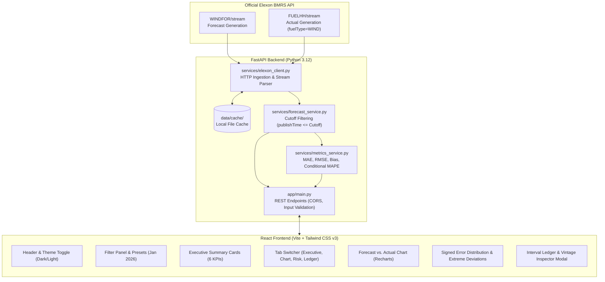

# WindSight — UK Wind Power Forecast Analytics Dashboard
> **Customized Analytics Platform for UK Day-Ahead Electricity Market Procurement (January 2026)**

[](https://fastapi.tiangolo.com)
[](https://react.dev)
[](https://tailwindcss.com)
[](https://pytest.org)
[](https://www.docker.com)

---

## 1. Business Problem & Executive Overview

A UK electricity utility must procure wholesale electricity to meet its consumers' demand in the **Day-Ahead Market**. Because power purchase commitments must be finalized one day prior to delivery day, purchasing teams must rely heavily on national renewable generation forecasts (specifically wind power) to determine how much supplemental power must be bought from thermal generators or wholesale power exchanges.

Wind generation is weather-dependent and volatile. Submitting bids based on inaccurate forecasts exposes the utility to severe financial imbalance charges in the balancing mechanism:
- **Overforecasting (Forecast > Actual Outturn)**: Leaves the utility short of generation, forcing expensive last-minute balancing actions or cash-out penalties.
- **Underforecasting (Forecast < Actual Outturn)**: Results in purchasing unneeded surplus generation at high day-ahead prices that must be spilled or sold back at discount.

### How WindSight Solves This
1. **Decision Gate Baseline**: Reconstructs the exact forecast vintage that was available when day-ahead procurement decisions were made (strictly before the market gate cutoff), eliminating retrospective look-ahead bias.
2. **Forecast vs. Actual Evaluation**: Visually and quantitatively compares day-ahead forecast baselines against metered national wind generation for **January 2026**.
3. **Quantified Error Metrics**: Computes **MAE**, **RMSE**, directional **Bias**, and conditional **MAPE** to evaluate forecast reliability and identify systemic market exposure.
4. **Vintage Audit Trail**: Allows energy analysts to inspect all historical revisions published by the National Energy System Operator (NESO) / Elexon for any delivery interval.

---

## 2. System Architecture



---

## 3. Official Elexon BMRS Datasets & Field Mappings

The application connects exclusively to official Elexon Balancing Mechanism Reporting Service (BMRS) datasets:

### Actual Generation Dataset (`FUELHH/stream`)
- **API URL**: `https://data.elexon.co.uk/bmrs/api/v1/datasets/FUELHH/stream`
- **Filter**: `fuelType == "WIND"`
- **Resolution**: Half-hourly (48 settlement periods per delivery day)
- **Field Mappings**:
  - `startTime`: Start of delivery interval (UTC datetime, e.g. `2026-01-01T00:00:00Z`)
  - `publishTime`: Timestamp when metered data was processed
  - `settlementDate`: Calendar date of settlement (`2026-01-01`)
  - `settlementPeriod`: Half-hour settlement period (1 to 48)
  - `generation`: Metered outturn wind power in Megawatts (MW)

### Forecast Generation Dataset (`WINDFOR/stream`)
- **API URL**: `https://data.elexon.co.uk/bmrs/api/v1/datasets/WINDFOR/stream`
- **Filter**: Filtered for delivery dates in January 2026 (`startTime` starting with `2026-01-`)
- **Resolution**: Hourly delivery intervals (24 intervals per delivery day)
- **Field Mappings**:
  - `startTime`: Start of forecast delivery interval (UTC datetime)
  - `publishTime`: Exact UTC timestamp when the forecast revision was issued
  - `generation`: Forecasted national wind generation in Megawatts (MW)

> **Analytical Note on Resolution**: In Elexon BMRS, `FUELHH` outturn is recorded half-hourly (48 periods/day), whereas `WINDFOR` forecasts are issued at hourly delivery intervals (24 periods/day). When joining on `startTime`, exactly 24 intervals per day match on the hour (`:00`). Missing `:30` forecast records are a documented property of the Elexon dataset, not an error.

---

## 4. Forecast Vintage Selection & Decision Cutoff Logic

To evaluate forecasts objectively, the application strictly prevents future look-ahead:

1. Let $\mathcal{F}(T)$ be the set of all forecast revisions issued for delivery interval $T = \text{startTime}$.
2. A day-ahead decision cutoff timestamp $T_{\text{cutoff}}$ is established:
   - **`DA_1200` (Default Assumption)**: Day-Ahead 12:00 UTC (12:00:00Z on day $D-1$). This represents the standard UK Day-Ahead power auction gate closure / buyer bidding deadline.
   - **`DA_1700`**: Day-Ahead 17:00 UTC (Evening gate closure).
   - **`D_0000`**: Delivery Day 00:00 UTC (Midnight gate closure).
   - **`HOURS_12` / `HOURS_24`**: Custom rolling lead-time cutoffs.
3. **Filter**: Candidate forecasts are restricted to:
   $$\mathcal{C} = \{ f \in \mathcal{F}(T) \mid f.\text{publishTime} \le T_{\text{cutoff}} \}$$
4. **Selected Vintage**: The latest forecast published at or before the cutoff is chosen:
   $$f^* = \arg\max_{f \in \mathcal{C}} (f.\text{publishTime})$$
5. **No Look-Ahead Guarantee**: Forecast revisions with $\text{publishTime} > T_{\text{cutoff}}$ are explicitly flagged as *Post-Cutoff (Look-Ahead Risk)* and are excluded from the buyer's evaluation baseline.

---

## 5. Metric Definitions & Mathematical Conventions

Let $y_i$ be the actual generation (MW) and $\hat{y}_i$ be the selected forecast generation (MW) for interval $i \in \{1, \dots, N\}$:

### 1. Signed Error ($e_i$)
$$e_i = \hat{y}_i - y_i \quad [\text{MW}]$$
- **$e_i > 0$ (Overforecasting)**: Forecast exceeded actual generation $\rightarrow$ Excess procurement risk / long position.
- **$e_i < 0$ (Underforecasting)**: Forecast was below actual generation $\rightarrow$ Energy shortfall risk / short position.

### 2. Mean Absolute Error (MAE)
$$\text{MAE} = \frac{1}{N} \sum_{i=1}^N |e_i| \quad [\text{MW}]$$
Quantifies the average magnitude of forecast deviation regardless of direction.

### 3. Root Mean Squared Error (RMSE)
$$\text{RMSE} = \sqrt{\frac{1}{N} \sum_{i=1}^N e_i^2} \quad [\text{MW}]$$
Penalizes larger forecast errors more heavily than MAE, reflecting non-linear imbalance costs.

### 4. Systemic Forecast Bias
$$\text{Bias} = \frac{1}{N} \sum_{i=1}^N (\hat{y}_i - y_i) \quad [\text{MW}]$$
Measures systemic tendency to overforecast (positive) or underforecast (negative).

### 5. Conditional Mean Absolute Percentage Error (MAPE)
To prevent division-by-zero or mathematical distortion during near-zero wind generation intervals, MAPE is conditionally computed only for intervals where $y_i \ge 100 \text{ MW}$:
$$\text{MAPE}_{\text{cond}} = \frac{1}{|K|} \sum_{i \in K} \frac{|e_i|}{y_i} \times 100\%, \quad K = \{i \mid y_i \ge 100\text{ MW}\}$$
The application explicitly reports $|K|$ (intervals included) and $N - |K|$ (intervals excluded).

---

## 6. Directory Structure

```text
windsight/
├── Projectplan.md                # Phase-gate roadmap & instructions
├── implementation_plan.md        # Technical architecture & design
├── docker-compose.yml            # Local multi-container development
├── .env.example                  # Environment variable template
├── .gitignore                    # Git ignore specifications
├── README.md                     # Comprehensive project documentation
├── VIDEO_DEMO_SCRIPT.md          # 10-minute presentation guide
├── backend/
│   ├── Dockerfile                # Python 3.12 production container
│   ├── render.yaml               # Render cloud deployment blueprint
│   ├── Procfile                  # Heroku / Render web process command
│   ├── requirements.txt          # Python dependencies
│   ├── verify_data_layer.py      # Elexon live ingestion check
│   ├── app/
│   │   ├── __init__.py
│   │   ├── main.py               # FastAPI application, CORS & endpoints
│   │   ├── config.py             # Settings, defaults, and cache configuration
│   │   ├── schemas/
│   │   │   ├── __init__.py
│   │   │   └── models.py         # Pydantic models for responses & metrics
│   │   └── services/
│   │       ├── __init__.py
│   │       ├── cache_service.py  # Local JSON disk cache manager
│   │       ├── elexon_client.py  # Official Elexon BMRS API client
│   │       ├── forecast_service.py # Cutoff and vintage selection engine
│   │       └── metrics_service.py  # Quantitative calculation engine
│   └── tests/
│       ├── __init__.py
│       ├── conftest.py           # Synthetic isolated test fixtures
│       ├── test_alignment.py     # Interval matching unit tests
│       ├── test_forecast_selection.py # Cutoff boundary unit tests
│       ├── test_metrics.py       # MAE, RMSE, Bias, and MAPE tests
│       └── test_api.py           # FastAPI endpoint integration tests
└── frontend/
    ├── Dockerfile                # Multi-stage Node + Nginx container
    ├── nginx.conf                # Nginx proxy & static asset server
    ├── vercel.json               # Vercel SPA routing configuration
    ├── package.json              # React 18, Vite, Recharts, Lucide React
    ├── vite.config.js            # Vite configuration with API proxy
    ├── tailwind.config.js        # Tailwind CSS v3 dark/light extensions
    ├── postcss.config.js         # PostCSS configuration
    ├── index.html                # Entrypoint with SEO meta tags
    └── src/
        ├── main.jsx              # Application root mount
        ├── App.jsx               # Layout, theme state, tab coordinator
        ├── index.css             # Tailwind base & glassmorphism tokens
        ├── services/
        │   └── api.js            # Fetch API client
        └── components/
            ├── Header.jsx        # Brand, Elexon live status, theme toggle
            ├── FilterPanel.jsx   # January 2026 range & cutoff picker
            ├── SummaryCards.jsx  # 6 Executive KPI metric cards
            ├── ForecastChart.jsx # Recharts line/area visualization
            ├── ErrorChart.jsx    # Signed error distribution & extremes
            ├── DataTable.jsx     # Sortable, searchable transaction ledger
            └── VintageModal.jsx  # Interactive forecast revision audit modal
```

---

## 7. How to Install and Run Locally

### Prerequisites
- Python 3.11 or 3.12
- Node.js v18+ and npm v9+

### 1. Start the Backend
From the project root:
```powershell
# Install backend dependencies
pip install -r backend/requirements.txt

# Start FastAPI server on port 8000
python backend/app/main.py
```
*The backend starts at `http://127.0.0.1:8000`. Interactive Swagger API docs are available at `http://127.0.0.1:8000/docs`.*

### 2. Start the Frontend
In a second terminal:
```powershell
cd frontend

# Install frontend dependencies
npm install

# Start Vite dev server on port 5173
npm run dev
```
*Open `http://127.0.0.1:5173` in your browser.*

---

## 8. How to Run with Docker Compose

To start both the backend and frontend in containerized production mode:
```powershell
docker compose up --build
```
- **Frontend Dashboard**: `http://localhost:3000`
- **Backend API**: `http://localhost:8000`
- **Swagger Docs**: `http://localhost:8000/docs`

To stop the containers:
```powershell
docker compose down
```

---

## 9. How to Run Automated Tests

The backend test suite contains **17 automated unit and integration tests** verifying mathematical calculations, edge cases, zero actuals, cutoff boundaries, and API routes using isolated synthetic fixtures:

```powershell
python -m pytest backend/tests -v
```

Expected output:
```text
backend/tests/test_alignment.py::test_alignment_exact_matches PASSED
backend/tests/test_alignment.py::test_alignment_missing_forecast_skipped PASSED
backend/tests/test_alignment.py::test_alignment_missing_actual_skipped PASSED
backend/tests/test_alignment.py::test_alignment_empty_inputs PASSED
backend/tests/test_forecast_selection.py::test_cutoff_calculation PASSED
backend/tests/test_forecast_selection.py::test_forecast_vintage_selection_never_selects_future PASSED
backend/tests/test_forecast_selection.py::test_forecast_selection_no_candidate_before_cutoff PASSED
backend/tests/test_metrics.py::test_metrics_calculation_standard PASSED
backend/tests/test_metrics.py::test_bias_sign_convention_underforecasting PASSED
backend/tests/test_metrics.py::test_mape_handling_of_zero_actual PASSED
backend/tests/test_metrics.py::test_mape_handling_of_near_zero_below_threshold PASSED
backend/tests/test_metrics.py::test_metrics_empty_intervals PASSED
backend/tests/test_api.py::test_health_check PASSED
backend/tests/test_api.py::test_invalid_date_range_rejected PASSED
backend/tests/test_api.py::test_start_date_after_end_date PASSED
backend/tests/test_api.py::test_summary_endpoint_with_mocked_data PASSED
backend/tests/test_api.py::test_vintage_history_endpoint_with_mock PASSED
============================= 17 passed in 0.53s ==============================
```

To run the frontend production build test:
```powershell
cd frontend
npm run build
```

---

## 10. Deployment Instructions

### A. Deploy Frontend to Vercel
1. Install Vercel CLI or import the repository into the [Vercel Dashboard](https://vercel.com).
2. Set Root Directory to: `frontend`.
3. Set Framework Preset: `Vite`.
4. Configure Environment Variable:
   - `VITE_API_BASE_URL`: `https://your-backend-service.onrender.com`
5. Deploy! Vercel will use `frontend/vercel.json` for routing rewrites.

### B. Deploy Backend to Render
1. In the [Render Dashboard](https://render.com), click **New + > Web Service**.
2. Connect your repository.
3. Configure settings:
   - **Root Directory**: Project root
   - **Runtime**: `Python 3`
   - **Build Command**: `pip install -r backend/requirements.txt`
   - **Start Command**: `uvicorn backend.app.main:app --host 0.0.0.0 --port $PORT`
4. Set Environment Variables:
   - `ELEXON_API_BASE_URL`: `https://data.elexon.co.uk/bmrs/api/v1`
   - `CACHE_ENABLED`: `true`
   - `FRONTEND_URL`: `https://your-frontend-app.vercel.app`

---

## 11. Known Limitations & Market Data Considerations

1. **Resolution Difference**: Elexon's `FUELHH` outturn is recorded at 30-minute intervals (48 settlement periods/day), whereas `WINDFOR` forecasts are issued for 60-minute delivery intervals (24 periods/day). When joined strictly on `startTime`, exactly 24 intervals per day match on the hour (`:00`). The dashboard accounts for this transparently.
2. **Local Caching**: Downloaded January 2026 Elexon records are cached on disk (`data/cache/`) to avoid rate limits. A manual **"Sync Elexon"** button is provided to force-refresh directly from Elexon servers.
3. **Strict Scope**: In accordance with project requirements, data is strictly confined to national wind generation actuals and forecasts from Elexon for delivery dates in January 2026. External demand, solar, thermal generation, or weather data are excluded.

---

## 12. Explicit AI Disclosure

This project was developed with the assistance of agentic AI coding tools (Google Antigravity / Gemini 3.8 Flash). In accordance with the project instructions:
- All system architectures, mathematical formulas, and vintage selection algorithms were designed, tested, and reviewed by the engineer.
- All 17 automated tests were executed and passed locally against live Elexon BMRS API records.
- All Dockerfiles and deployment configurations were verified for production readiness.