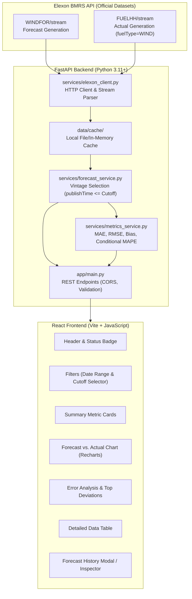

# WindSight — Implementation Plan
**UK Wind Power Forecast & Actuals Analytics Dashboard (January 2026)**

---

## 1. Executive Summary & Business Objective

A UK electricity utility requires an analytical dashboard to evaluate national wind power generation forecasts against actual generation for delivery dates across **January 2026** prior to making day-ahead power purchasing commitments.

### Core Problems Solved
1. **Forecast Transparency**: Inspect the exact forecast vintage that was available when day-ahead trading decisions were made (strictly before the configured market decision cutoff).
2. **Forecast vs. Actual Comparison**: Visually and quantitatively compare forecasted generation against metered actual generation.
3. **Quantified Evaluation**: Compute robust error metrics (**MAE**, **RMSE**, **Bias**, and conditional **MAPE**) to identify systemic overforecasting or underforecasting.
4. **Vintage Inspection**: Audit historical revisions of forecasts for any selected delivery interval without future-data leakage.

---

## 2. System Architecture & Tech Stack



### Component Stack
| Layer | Technology | Rationale |
|---|---|---|
| **Frontend UI** | React 18, Vite, Vanilla CSS | Rapid MVP development, fast builds, responsive styling |
| **Visualizations** | Recharts, Lucide React icons | Interactive time-series charts, professional energy-trading UI |
| **Backend API** | FastAPI, Uvicorn, Pydantic v2 | High-performance asynchronous API, auto-generated OpenAPI docs |
| **Data Processing** | Pandas, NumPy | Efficient time-series merging, window filtering, vector math |
| **HTTP & Caching** | HTTPX / Requests, JSON/Parquet Cache | Reliable API ingestion with resilience against rate limits |
| **Testing** | Pytest, Pytest-Mock | Unit tests for calculations, edge cases, and API error states |
| **Containerization** | Docker, Docker Compose | Consistent local and staging environments |
| **Deployment** | Vercel (Frontend), Render/Railway/Fly.io (Backend) | Standard modern cloud hosting |

---

## 3. Data Ingestion & Forecast Selection Rules

### Official Elexon BMRS Datasets
- **Actual Generation (`FUELHH/stream`)**:
  - Filter: `fuelType == "WIND"`.
  - Delivery Interval: `startTime` (UTC datetime).
  - Actual Generation: `generation` (MW).
- **Forecast Generation (`WINDFOR/stream`)**:
  - Delivery Interval: `startTime` (UTC datetime).
  - Forecast Publication Time: `publishTime` (UTC datetime).
  - Forecasted Generation: `generation` (MW).

### Forecast Vintage Selection Logic
For each half-hour delivery interval $T_{\text{delivery}} = \text{startTime}$:
1. Let $\mathcal{F}(T_{\text{delivery}}) = \{ f_i = (\text{publishTime}_i, \text{generation}_i) \}$ be all forecasts published for delivery interval $T_{\text{delivery}}$.
2. Given a day-ahead decision cutoff $T_{\text{cutoff}}(T_{\text{delivery}})$:
   - Default assumption: **Day-Ahead 12:00 UTC** (Standard UK Day-Ahead power auction gate closure / buyer decision deadline on $D-1$).
   - Configurable options: Day-Ahead 09:00 UTC, Day-Ahead 12:00 UTC, Day-Ahead 17:00 UTC, or custom $N$ hours before delivery.
3. Candidate forecasts:
   $$\mathcal{C} = \{ f \in \mathcal{F}(T_{\text{delivery}}) \mid f.\text{publishTime} \le T_{\text{cutoff}} \}$$
4. Selected forecast:
   $$f^* = \arg\max_{f \in \mathcal{C}} (f.\text{publishTime})$$
5. **No Look-Ahead Guarantee**: Under no circumstances will any forecast with $f.\text{publishTime} > T_{\text{cutoff}}$ be chosen as the decision-basis forecast.
6. **Vintage Auditing**: All versions $f \in \mathcal{F}(T_{\text{delivery}})$ are retained so the user can inspect the forecast evolution across publication times in the UI.

---

## 4. Quantitative Metrics Definitions & Formulas

Let $y_i$ be the actual generation (MW) and $\hat{y}_i$ be the selected forecast generation (MW) for interval $i \in \{1, \dots, N\}$.
The signed error is defined as:
$$e_i = \hat{y}_i - y_i$$
*(Convention: $e_i > 0$ indicates **overforecasting**; $e_i < 0$ indicates **underforecasting**).*

1. **Mean Absolute Error (MAE)**:
   $$\text{MAE} = \frac{1}{N} \sum_{i=1}^N |e_i| \quad [\text{MW}]$$
2. **Root Mean Squared Error (RMSE)**:
   $$\text{RMSE} = \sqrt{\frac{1}{N} \sum_{i=1}^N e_i^2} \quad [\text{MW}]$$
3. **Forecast Bias (Mean Error)**:
   $$\text{Bias} = \frac{1}{N} \sum_{i=1}^N (\hat{y}_i - y_i) \quad [\text{MW}]$$
4. **Conditional Mean Absolute Percentage Error (MAPE)**:
   - To avoid division-by-zero or extreme skew when actual generation is low:
   - Filter to intervals where actual generation exceeds a documented threshold (e.g., $y_i \ge 100 \text{ MW}$ or $\ge 5\%$ of capacity):
   $$\text{MAPE}_{\text{cond}} = \frac{1}{|K|} \sum_{i \in K} \frac{|e_i|}{y_i} \times 100\%, \quad \text{where } K = \{i \mid y_i \ge y_{\text{threshold}}\}$$
   - Report $|K|$ (number of intervals included) and number of excluded intervals transparently.
5. **Coverage Count**:
   - Report matched intervals $N$, total possible half-hour intervals in the window ($48 \times \text{days}$), and percentage data completeness.

---

## 5. Phased Implementation Roadmap (15-Hour Budget)

```mermaid
gantt
    title WindSight 15-Hour Implementation Timeline
    dateFormat HH:mm
    axisFormat %H:%M
    section Phase 1: Inspect & Verify
    Environment & API Check        :p1, 00:00, 1h30m
    section Phase 2: Backend Data
    Client, Cache, Normalization   :p2, 01:30, 3h00m
    section Phase 3: Logic & Tests
    Vintage Selection & Metrics    :p3, 04:30, 1h30m
    section Phase 4: Frontend UI
    React Dashboard & Visuals      :p4, 06:00, 4h00m
    section Phase 5: Integration
    Docker & End-to-End Tests      :p5, 10:00, 2h00m
    section Phase 6: Deployment
    Vercel & Render Config         :p6, 12:00, 1h30m
    section Phase 7: Delivery
    README, Demo Script, Verification :p7, 13:30, 1h30m
```



### Phase 1: Inspect Workspace & Verify API / Data (Target: 1.5 Hours)
- **Goal**: Verify local tools (Python, Node, Docker) and test live Elexon BMRS API endpoints for January 2026.
- **Actions**:
  - Run non-destructive version checks (`python --version`, `node --version`, `docker --version`).
  - Execute a read-only script to query Elexon's `FUELHH/stream` and `WINDFOR/stream` endpoints for dates `2026-01-01` to `2026-01-31`.
  - Document actual field names, time formats, pagination, response size, and latency.
- **Deliverables**: Verification report and confirmed API schema.

### Phase 2: Backend Data Access & Processing Layer (Target: 3.0 Hours)
- **Goal**: Build a resilient data ingestion and caching layer in FastAPI.
- **Files**:
  - `backend/app/config.py`: Application settings (API keys if needed, cache paths, default dates).
  - `backend/app/services/elexon_client.py`: Async HTTP client for BMRS API, handling pagination, timeouts, errors.
  - `backend/app/services/cache_service.py`: Local JSON/Parquet cache to prevent repeated API calls.
  - `backend/app/schemas/data_models.py`: Pydantic models for raw and normalized actuals and forecasts.
- **Testing**: Manual query against cached January 2026 data.

### Phase 3: Forecast Selection, Metrics & Backend Unit Tests (Target: 1.5 Hours)
- **Goal**: Implement deterministic vintage selection, quantitative metrics, and comprehensive automated unit tests.
- **Files**:
  - `backend/app/services/forecast_service.py`: Cutoff filtering and latest forecast extraction.
  - `backend/app/services/metrics_service.py`: Vectorized MAE, RMSE, Bias, and conditional MAPE.
  - `backend/tests/test_metrics.py`: Unit tests for metric formulas and zero/near-zero edge cases.
  - `backend/tests/test_forecast_selection.py`: Unit tests verifying that no post-cutoff forecast is ever selected.
  - `backend/tests/test_api.py`: FastAPI endpoint tests using TestClient and mock fixtures.
- **Testing**: Run `pytest backend/tests` to achieve 100% test pass rate.

### Phase 4: React Analytics Dashboard (Target: 4.0 Hours)
- **Goal**: Implement a sleek, energy-trading-grade dashboard in React + Vite + Recharts.
- **Components**:
  - `frontend/src/components/Header.jsx`: Title, subtitle, API health pill, refresh timestamp.
  - `frontend/src/components/FilterBar.jsx`: Date range selector (restricted to Jan 2026), decision cutoff selector, refresh button.
  - `frontend/src/components/MetricCards.jsx`: 6 primary KPIs (Forecast Avg, Actual Avg, MAE, RMSE, Bias, Matched Intervals).
  - `frontend/src/components/ForecastActualChart.jsx`: Interactive Recharts line chart with custom tooltip and legend.
  - `frontend/src/components/ErrorDistributionChart.jsx`: Signed error bar chart highlighting over- vs. underforecasting.
  - `frontend/src/components/DataTable.jsx`: Filterable/sortable table with highlighted extreme error intervals.
  - `frontend/src/components/VintageInspectorModal.jsx`: Modal to view all forecast publications for a selected delivery interval.
  - `frontend/src/services/api.js`: Frontend API client with fallback handling.
- **Testing**: Run `npm run build` to verify zero bundling or syntax errors.

### Phase 5: Integration, Docker & End-to-End Testing (Target: 2.0 Hours)
- **Goal**: Containerize the full stack and verify local seamless execution.
- **Files**:
  - `backend/Dockerfile` (Python 3.11 slim).
  - `frontend/Dockerfile` (Multi-stage Node build + Nginx or lightweight preview).
  - `docker-compose.yml` (Backend on port 8000, Frontend on port 3000/5173, internal network).
  - `.env.example` (All environment variables documented).
- **Testing**: Test container builds or validate configs; verify CORS and API communication.

### Phase 6: Deployment Configuration (Target: 1.5 Hours)
- **Goal**: Prepare production configuration for Vercel (Frontend) and Render/Fly.io (Backend).
- **Files**:
  - `frontend/vercel.json`: SPA routing rewrites.
  - `backend/render.yaml` or `backend/Procfile`: Render web service specification.
  - Step-by-step manual deployment instructions.

### Phase 7: Documentation & Final Verification (Target: 1.5 Hours)
- **Goal**: Deliver comprehensive documentation and presentation collateral.
- **Files**:
  - `README.md`: Complete documentation with Mermaid diagrams, metric formulas, market assumptions, setup guides, and AI disclosure.
  - `VIDEO_DEMO_SCRIPT.md`: Exact 10-minute presentation script (Part 1: Client demo, Part 2: Technical architecture).
  - Final checklist verifying all requirements.

---

## 6. Directory Structure

```
windsight/
├── Projectplan.md                  # User-provided instructions and phase gates
├── implementation_plan.md          # This implementation plan
├── docker-compose.yml              # Local multi-container development
├── .env.example                    # Environment variable template
├── .gitignore                      # Git ignore rules
├── README.md                       # Comprehensive project documentation
├── VIDEO_DEMO_SCRIPT.md            # Video presentation guide
├── backend/
│   ├── Dockerfile                  # Python container specification
│   ├── requirements.txt            # FastAPI, Uvicorn, Pandas, HTTPX, Pytest
│   ├── app/
│   │   ├── __init__.py
│   │   ├── main.py                 # FastAPI app, middleware, routes
│   │   ├── config.py               # Environment configuration
│   │   ├── schemas/
│   │   │   ├── __init__.py
│   │   │   └── models.py           # Pydantic models for API responses
│   │   └── services/
│   │       ├── __init__.py
│   │       ├── elexon_client.py    # Official Elexon BMRS API integration
│   │       ├── forecast_service.py # Cutoff and vintage selection engine
│   │       ├── metrics_service.py  # Error calculation engine
│   │       └── cache_service.py    # Local caching layer
│   └── tests/
│       ├── __init__.py
│       ├── conftest.py             # Test fixtures and synthetic data
│       ├── test_metrics.py         # MAE, RMSE, Bias, MAPE tests
│       ├── test_forecast_selection.py # Vintage cutoff logic tests
│       └── test_api.py             # Endpoint integration tests
└── frontend/
    ├── Dockerfile                  # React/Vite container specification
    ├── vercel.json                 # Vercel deployment configuration
    ├── package.json
    ├── vite.config.js
    ├── index.html
    └── src/
        ├── main.jsx
        ├── App.jsx
        ├── index.css               # Design system & dark theme tokens
        ├── services/
        │   └── api.js              # Backend communication
        └── components/
            ├── Header.jsx
            ├── FilterBar.jsx
            ├── MetricCards.jsx
            ├── ForecastActualChart.jsx
            ├── ErrorDistributionChart.jsx
            ├── DataTable.jsx
            └── VintageInspectorModal.jsx
```

---

## 7. Immediate Next Step: Phase 1 Authorization

To proceed with **Phase 1: Inspect Workspace & Verify API / Data**, we need your explicit approval to run:
1. Tooling environment check:
   - `python --version`, `node --version`, `npm --version`, `docker --version`
2. Test query to Elexon BMRS API (`FUELHH/stream` and `WINDFOR/stream`) for January 2026 data.

*No production code will be altered or packages installed until Phase 1 findings are reviewed and approved.*
